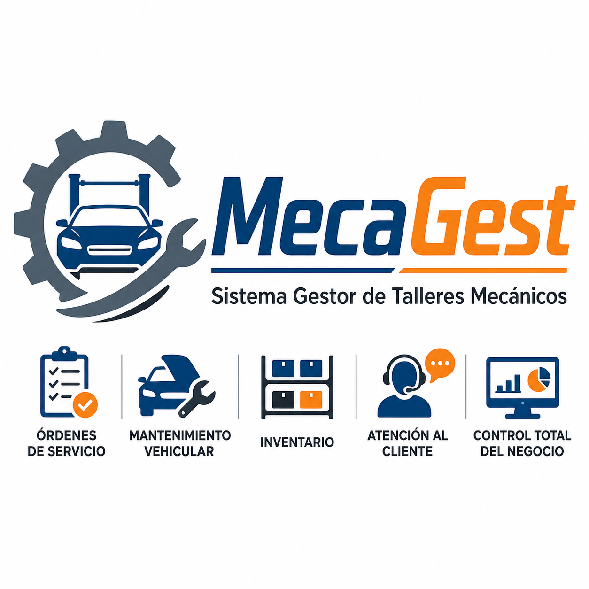

# Sistema Gestor de Talleres Mecánicos  (MecaGest)
---
### 1. Identidad Gráfica

#### Logotipos

<table>
   <td align="center">Logo de Producto</td>
   <td align="center">Logo de Empresa</td>
  <tr>
    <td>    </td>
    <td>    </td>
   
  </tr>
 
</table>


### Índice
---
1. [Descripción general](#descripción-general)
2. [Empresa desarrolladora](#empresa-desarrolladora)
3. [Identidad del software](#identidad-del-software)
4. [Contexto del proyecto](#contexto-del-proyecto)
5. [Planteamiento del problema](#planteamiento-del-problema)
6. [Propuesta de solución](#propuesta-de-solución)
7. [Objetivo general](#objetivo-general)
8. [Objetivos específicos](#objetivos-específicos)
9. [Alcance general](#alcance-general)
10. [Módulos principales](#módulos-principales)
11. [Estructura documental del repositorio](#estructura-documental-del-repositorio)
12. [Estructura general del repositorio](#estructura-general-del-repositorio)
13. [Tecnologías propuestas](#tecnologías-propuestas)
14. [Colaboradores](#colaboradores)
15. [Organigrama del equipo](#organigrama-del-equipo)
16. [Estado del proyecto](#estado-del-proyecto)
17. [Licencia](#licencia)

---

# Descripción general

El **Sistema Gestor de Talleres Mecánicos** es un proyecto de software de escritorio orientado a la administración de operaciones en talleres mecánicos locales, especialmente aquellos administrados por pequeños empresarios, autoempleados o negocios familiares.

El sistema busca apoyar la digitalización de procesos que comúnmente se realizan de manera manual, como el registro de clientes, vehículos, órdenes de servicio, refacciones, pagos, empleados y reportes básicos del taller.

La aplicación propuesta permitirá centralizar información operativa del negocio para mejorar la organización, reducir errores administrativos, facilitar el seguimiento de servicios y apoyar la toma de decisiones del propietario o encargado del taller.

---

# Empresa desarrolladora

<div align="center">

</div>

## Soft3CDev

**Soft3CDev** es la empresa desarrolladora responsable del análisis, diseño, documentación y desarrollo del sistema **MecaGest Desktop**.

El nombre **Soft3CDev** representa una identidad enfocada en el desarrollo de software bajo tres principios clave:

| Elemento | Significado |
|---|---|
| **Soft** | Desarrollo de software |
| **3C** | Código, Creatividad y Calidad |
| **Dev** | Desarrollo tecnológico y soluciones digitales |

Soft3CDev se plantea como un equipo de desarrollo académico/profesional enfocado en crear soluciones de software útiles, organizadas y adaptadas a problemas reales de pequeñas empresas locales.

## Propósito de Soft3CDevv

El propósito de Soft3CDev en este proyecto es diseñar una solución tecnológica que ayude a talleres mecánicos a mejorar sus procesos administrativos y operativos mediante una aplicación de escritorio clara, funcional y adaptable a su contexto.

---

# Identidad del software

<div align="center">




</div>

## Nombre del software

**MecaGest Desktop**

## Nombre completo del proyecto

**Sistema Gestor de Talleres Mecánicos**

## Siglas sugeridas

**SGTM**

## Descripción de la identidad

La identidad gráfica de **MecaGest Desktop** integra elementos visuales relacionados con:

- Vehículos.
- Herramientas.
- Engranes.
- Órdenes de servicio.
- Inventario.
- Atención al cliente.
- Control administrativo.

Su diseño busca comunicar confianza, organización, profesionalismo y cercanía con el sector automotriz local.

## Paleta de colores sugerida

| Color | Uso sugerido | Significado |
|---|---|---|
| Azul oscuro | Elementos principales | Confianza, estabilidad y profesionalismo |
| Naranja | Botones y acentos visuales | Energía, acción y dinamismo |
| Gris acero | Elementos secundarios | Herramientas, maquinaria y entorno mecánico |
| Grafito | Texto principal | Formalidad y legibilidad |
| Blanco | Fondos | Limpieza visual y orden |

---

# Contexto del proyecto

Los talleres mecánicos locales cumplen un papel importante dentro de la economía de pequeñas comunidades y zonas urbanas, ya que ofrecen servicios de reparación, mantenimiento preventivo y correctivo de vehículos particulares o comerciales.

Sin embargo, muchos de estos negocios operan con procesos administrativos poco digitalizados. Es común que utilicen libretas, notas físicas, hojas de cálculo o registros informales para administrar sus servicios.

Entre las actividades más frecuentes de un taller mecánico se encuentran:

- Recepción de vehículos.
- Registro de clientes.
- Diagnóstico de fallas.
- Cotización de servicios.
- Asignación de mecánicos.
- Compra y uso de refacciones.
- Seguimiento de reparaciones.
- Registro de pagos.
- Entrega del vehículo.
- Consulta de historial de servicios.

La ausencia de un sistema especializado puede provocar pérdida de información, retrasos, duplicidad de registros y poca claridad sobre el estado real del negocio.

---

# Planteamiento del problema

Los pequeños talleres mecánicos locales presentan dificultades para administrar de manera eficiente sus operaciones diarias debido al uso de procesos manuales o herramientas no especializadas.

Esta situación afecta el control de clientes, vehículos, órdenes de servicio, inventario, pagos y reportes administrativos. Como consecuencia, el propietario o encargado del taller puede tener problemas para dar seguimiento a los trabajos pendientes, consultar historiales de reparación, identificar refacciones disponibles o conocer los ingresos generados en un periodo determinado.

La falta de centralización de la información también puede afectar la atención al cliente, ya que se dificulta informar con precisión el avance de una reparación, el costo actualizado del servicio o el historial previo del vehículo.

Por ello, se identifica la necesidad de desarrollar un sistema de escritorio que permita organizar y controlar las operaciones principales de un taller mecánico local de forma sencilla, clara y accesible.

---

# Propuesta de solución

Se propone desarrollar **MecaGest Desktop**, un sistema de escritorio para la gestión de talleres mecánicos locales.

La solución permitirá registrar y consultar información relacionada con clientes, vehículos, órdenes de servicio, servicios mecánicos, refacciones, pagos, empleados y reportes básicos.

El sistema estará orientado a pequeños empresarios que necesitan una herramienta práctica para mejorar la administración de su negocio sin depender de plataformas complejas o costosas.

## Beneficios esperados

- Mejor organización de la información del taller.
- Reducción de errores en registros manuales.
- Consulta rápida del historial de vehículos.
- Seguimiento claro de órdenes de servicio.
- Control básico de refacciones e inventario.
- Registro de pagos y adeudos.
- Mejora en la atención al cliente.
- Apoyo en la toma de decisiones del propietario.

---

# Objetivo general

Desarrollar un sistema de escritorio para la gestión de operaciones de talleres mecánicos locales, que permita administrar clientes, vehículos, órdenes de servicio, inventario, pagos y reportes básicos, con el propósito de mejorar el control administrativo y operativo de pequeños empresarios del sector automotriz.

---

# Objetivos específicos

1. Analizar las necesidades operativas de talleres mecánicos locales para identificar los procesos que pueden ser digitalizados.

2. Diseñar una estructura documental que permita organizar el análisis, diseño, desarrollo, pruebas y manuales del sistema.

3. Definir los módulos principales del sistema de acuerdo con las actividades comunes de un taller mecánico.

4. Diseñar una base de datos que permita almacenar información de clientes, vehículos, servicios, refacciones, empleados, órdenes de servicio y pagos.

5. Desarrollar una aplicación de escritorio con una interfaz clara y fácil de usar.

6. Implementar funcionalidades básicas para el registro, consulta, actualización y eliminación de información.

7. Generar reportes básicos que apoyen el seguimiento de las operaciones del taller.

8. Elaborar documentación técnica y de usuario que facilite la comprensión, instalación y uso del sistema.

---

# Alcance general

El sistema contempla la gestión básica de los siguientes procesos:

| Área | Descripción general |
|---|---|
| Clientes | Registro y consulta de clientes del taller |
| Vehículos | Administración de vehículos asociados a clientes |
| Órdenes de servicio | Registro y seguimiento de trabajos mecánicos |
| Servicios | Catálogo de servicios ofrecidos |
| Inventario | Control básico de refacciones |
| Empleados | Registro del personal del taller |
| Pagos | Control de anticipos, saldos y liquidaciones |
| Reportes | Consulta de información operativa básica |

---

# Módulos principales

## Módulo de clientes

Permitirá registrar y consultar la información de los clientes que solicitan servicios en el taller.

## Módulo de vehículos

Permitirá registrar los vehículos atendidos, asociándolos con su respectivo propietario.

## Módulo de órdenes de servicio

Permitirá registrar el ingreso de vehículos, diagnóstico, servicios solicitados, refacciones utilizadas, costos, estatus y fecha estimada de entrega.

## Módulo de servicios

Permitirá administrar un catálogo básico de servicios ofrecidos por el taller, como afinación, cambio de aceite, revisión de frenos, suspensión, diagnóstico general, entre otros.

## Módulo de inventario

Permitirá controlar refacciones, consumibles y piezas utilizadas durante los servicios.

## Módulo de empleados

Permitirá registrar al personal que participa en las operaciones del taller.

## Módulo de pagos

Permitirá registrar anticipos, pagos completos, adeudos y métodos de pago.

## Módulo de reportes

Permitirá consultar información general del negocio, como órdenes pendientes, servicios realizados, ingresos por periodo e inventario bajo.

---

# Estructura documental del repositorio

Este README funciona como documento principal de presentación del proyecto.

Los documentos específicos como requerimientos funcionales, requerimientos no funcionales, reglas de negocio, base de datos, casos de uso, pruebas y manuales se encuentran organizados en subcarpetas dentro de `docs/`.

## Documentación principal

| Carpeta | Contenido | Descripción |
|---|---|---|
| [`docs/01-contexto/`](./docs/01-contexto/) | Contexto, problema y justificación | Documentos que explican el origen y necesidad del proyecto |
| [`docs/02-analisis/`](./docs/02-analisis/) | Requerimientos, reglas de negocio e historias de usuario | Documentación del análisis funcional del sistema |
| [`docs/03-diseno/`](./docs/03-diseno/) | Arquitectura, interfaces y diagramas | Diseño general del sistema |
| [`docs/04-base-datos/`](./docs/04-base-datos/) | Modelo de datos, diccionario y scripts | Documentación relacionada con la base de datos |
| [`docs/05-desarrollo/`](./docs/05-desarrollo/) | Configuración, estructura técnica y convenciones | Información para desarrolladores |
| [`docs/06-pruebas/`](./docs/06-pruebas/) | Plan de pruebas y evidencias | Validación del funcionamiento del sistema |
| [`docs/07-manuales/`](./docs/07-manuales/) | Manual técnico y manual de usuario | Guías de instalación, operación y mantenimiento |
| [`docs/08-gestion-proyecto/`](./docs/08-gestion-proyecto/) | Cronograma, roles y control de cambios | Seguimiento administrativo del proyecto |
| [`docs/09-evidencias/`](./docs/09-evidencias/) | Capturas, prototipos y avances | Evidencias visuales del desarrollo |
| [`docs/assets/`](./docs/assets/) | Imágenes y recursos gráficos | Logos, capturas y diagramas auxiliares |

---

# Documentos específicos por subcarpeta

## `docs/01-contexto/`

Documentos sugeridos:

```txt
contexto-del-proyecto.md
planteamiento-del-problema.md
justificacion.md
propuesta-de-solucion.md
objetivos.md
alcances-limitaciones.md
```


### TABLA DE COLABORADORES

| Nombre                        | Usuario             | Puesto |
|-------------------------------|---------------------|--------|
| Nombre del Integrante 1   | [UsuarioGitHub1](https://github.com/usuarioGitHub1)        | Líder de Proyecto       |
| Nombre del Integrante 2       | [UsuarioGitHub2](https://github.com/usuarioGitHub1)       |   Administrador de Bases de Datos     |
| Nombre del Integrante 3    | [UsuarioGitHub3](https://github.com/usuarioGitHub1)             |  Líder de Desarrollo      |
| Nombre del Integrante 4        | [UsuarioGitHub4](https://github.com/usuarioGitHub1)            | Ingeniero de Calidad       |
| M.T.I. Marco A. Ramírez Hdez.       | [MTI-MarcoRH](https://github.com/MTI-MarcoRH)            | Cliente       |


| Nombre                        | Usuario             | Puesto |Ultima acción|
|-------------------------------|---------------------|--------|---|
| M.T.I. Marco A. Ramírez   | [MTI-MarcoRH](https://github.com/MTI-MarcoRH)        | Líder de Proyecto       | Creación del readme.md principal del proyecto 
| Jesús Yahir Calderón López        | [250802-eng](https://github.com/250802-eng)       |   Administrador de Bases de Datos     | Carga del Modelo E-R|
| Carlos Eduardo Antonio Alvarez    | [charles-antt](https://github.com/charles-antt)             |  Líder de Desarrollo      |
| Bertha Hernández Aranda        | [251113-BerthaHernandezAranda](https://github.com/251113-BerthaHernandezAranda)            | Ingeniero de Calidad       |
| Jeovani Cantellano Vargas        | [Jeovany-Vargas](https://github.com/Jeovany-Vargas)            | Cliente     |
